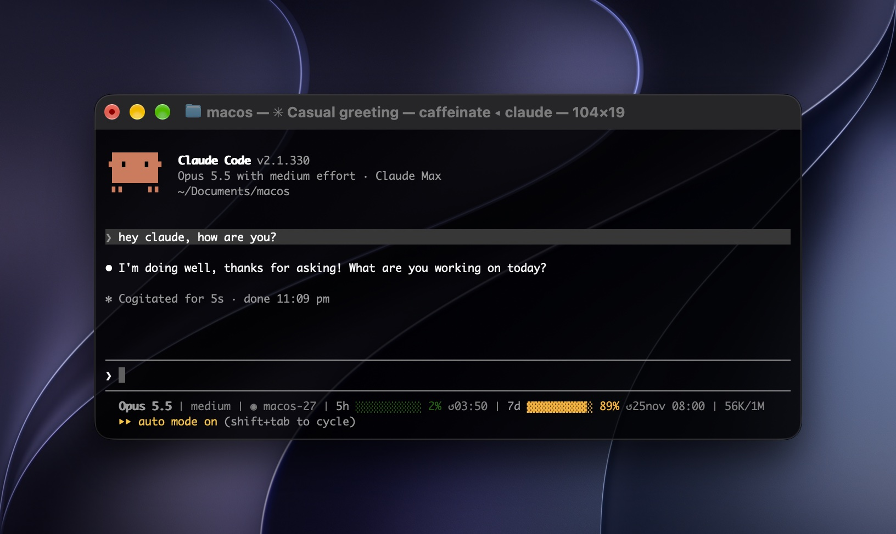
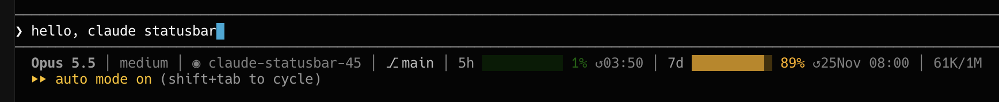

# claude-statusbar

A cross-platform status line for Claude Code: model, effort, session, git, quota windows and context usage, each one switchable.



```text
Opus 5.5 │ high │ ◉ api-worker │ ⎇ feat/x ⌂ wt-a ↑2 │ 5h ▓▓▓▓▓▓▓░░░ 74% ↺16:59 │ 7d ▓▓░░░░░░░░ 21% ↺18 Nov 07:59 │ 163K/200K
```

## Requirements

- Node.js 22.13 or newer
- `git` on your `PATH` (optional; without it the git segment is simply hidden)
- macOS, Linux or Windows

## Install

```bash
npm i -g @hhsm95/claude-statusbar
claude-statusbar init
```

`init` asks which segments you want (all are pre-selected), writes `statusbar.json` and sets the `statusLine` entry of Claude Code's `settings.json`:

```json
{ "type": "command", "command": "claude-statusbar", "padding": 0, "refreshInterval": 30 }
```

Every other key of `settings.json` is left untouched. If you already had a different status line, `init` asks before replacing it and stores the previous one in `statusbar.json` so `uninstall` can restore it.

For a non-interactive install (CI, scripts, dotfiles) use `claude-statusbar init --yes`. It is also used automatically when stdin is not a TTY.

Other commands: `claude-statusbar details` (see [Details](#details)), `claude-statusbar --help` / `-h` and `claude-statusbar --version` / `-v`.

## Segments

Segments are always printed in this order, joined by a dim ` │ `. A segment with no data is skipped.



| id | What it shows | Colors / thresholds |
|---|---|---|
| `model` | Model display name, e.g. `Opus 5.5` | bold |
| `effort` | Effort level, e.g. `high` | dim gray |
| `session` | `◉ <session name> · <start time>` | dim |
| `git` | `⎇ <branch>` (short sha when HEAD is detached), `⌂ <folder>` for a linked worktree, `↑<n>` commits ahead of the base branch | branch light gray, worktree dim, ahead count green |
| `fiveHour` | 5-hour quota window: `5h <bar> <pct>%` plus `↺<reset time>` | green below 70%, orange from 70%, red from 90% |
| `sevenDay` | 7-day quota window, same format with label `7d` | same as above |
| `context` | Tokens used over window size, e.g. `163K/200K`; `ctx <pct>%` when only a percentage is available | dim below 80%, orange from 80%, red from 90% |
| `cache` | Prompt-cache expiry warning: `⏱ cache <n>m` before it expires, `⚠ cache expired · <tokens> tok` after. Hidden while the cache is warm | orange in the last 10 min (1h cache) or 2 min (5m cache), red once expired |

Details:

- The bar has 10 cells (`▓` filled, `░` empty). The printed percentage drives the color.
- The reset time is `HH:MM` (local time) when less than 24 hours away, otherwise `DD Mon HH:MM` (for example `18 Nov 07:59`). An already expired window shows 0% and no reset mark.
- The session start time uses the same format: `HH:MM` when the session started less than 24 hours ago, otherwise `DD Mon HH:MM`. It is when the current Claude Code process started (`startedAt` in Claude Code's session file), so resuming a session (`claude --resume` or `--continue`) resets it to the resume time. The prompt cache is not affected: it is keyed by the conversation content, not by the process, so a session resumed within the cache lifetime still hits the cache, and the `cache` segment keeps counting from the last request.
- `cache` reads the end of the session transcript to find when the last request started and which cache lifetime it used: 1 hour on subscriptions, 5 minutes in usage overage or on some API-key setups. Every request restarts that lifetime, so only idle time makes the cache expire. The next message after expiry re-sends the whole context at the cache-write price, which is what the token count in the red state measures.
- The git base branch is `origin/HEAD`'s target (preferring the local branch of the same name), else local `main`, else `master`, else the upstream branch. With no base there is no ahead count.

### Narrow terminals

Claude Code passes the terminal width to the status line in the `COLUMNS` environment variable, and it updates when you resize the window. When the full line does not fit, it is shortened in this order, stopping at the first step that fits:

1. The git branch and worktree names are truncated with `…`, both to the same length, never below 8 characters.
2. The quota bars are removed, keeping the percentages and reset times. The names get back as much length as now fits.
3. If it still does not fit, that most compact line wraps onto more lines, filled in segment order, so nothing is cut off on the right. A single segment wider than the window takes a line of its own. No segment is hidden for lack of space.

Without `COLUMNS` (for example when running `claude-statusbar` by hand) the line is never shortened. This was verified in Warp and macOS Terminal.app; on other terminals and platforms the line falls back to full length if `COLUMNS` is not provided.

## Configuration

Settings live in `statusbar.json` inside Claude Code's config directory: `~/.claude/` by default, or `$CLAUDE_CONFIG_DIR` when that variable is set.

```json
{
  "segments": {
    "model": true,
    "effort": false,
    "session": true,
    "git": true,
    "fiveHour": true,
    "sevenDay": true,
    "context": true,
    "cache": true
  }
}
```

- A segment set to `false` is not computed or printed (a disabled `git` runs no git command).
- Missing ids default to `true`. Unknown keys and non-boolean values are ignored.
- A missing, corrupt or non-object file never breaks rendering: all segments are enabled.
- Set `NO_COLOR` to any non-empty value to print plain text with no ANSI escape sequences.

## Details

```bash
claude-statusbar details
```

Run it inside Claude Code as `! claude-statusbar details` to see the full, untruncated values behind the status line: model, effort, session, git branch and worktree, quota windows with their reset times, context token counts, cache TTL and the session cost. Segments disabled in `statusbar.json` are skipped, and rows without data are omitted. The header shows how long ago the data was updated.

Each render saves Claude Code's JSON as a snapshot in `<claude dir>/statusbar/snapshots/<session id>.json`, and `details` reads the one for the current session (`CLAUDE_CODE_SESSION_ID`). The quota windows are the exception: Claude Code can hand an idle session an outdated quota, and the quota belongs to the account, so `details` takes the 5h and 7d values from whichever snapshot saw the most recent window (latest reset time, then highest usage). Snapshots older than 7 days are pruned. `uninstall` leaves `<claude dir>/statusbar/` in place; delete it by hand if you no longer want the snapshots. `details` exits with code 1 outside Claude Code or before the status line has rendered once.

## Uninstall

```bash
claude-statusbar uninstall
npm rm -g @hhsm95/claude-statusbar
```

`uninstall` restores the previous status line if `init` stored one, or removes the `statusLine` entry otherwise. If `statusLine` points to something else it does nothing. `statusbar.json` stays on disk.

## Windows notes

- Install with `npm i -g @hhsm95/claude-statusbar`; npm creates the `claude-statusbar` shims that Claude Code runs.
- The glyphs (`│ ▓ ░ ◉ ⎇ ⌂ ↑ ↺`) render in Windows Terminal. Legacy consoles may show boxes.
- If `git` is not on your `PATH`, the git segment is hidden.

## Troubleshooting

- **A segment is missing.** Segments with no data are hidden on purpose: for example the quota windows appear only when Claude Code sends `rate_limits`, and git only inside a repository. Also check `statusbar.json` for a `false` toggle.
- **The session name does not show.** It is read on a best-effort basis from `<claude dir>/sessions/*.json`, an undocumented Claude Code internal that may change. If the format changes the segment is hidden rather than breaking anything.
- **The line feels slow in a huge repo or on a network drive.** Each git call has a 1 second timeout. Set `"git": false` in `statusbar.json` to disable the segment.
- **The line shows `no data`.** Claude Code sent nothing usable on stdin, or every segment is disabled or empty.

## Roadmap

Not in 0.1.0, planned or under consideration:

- Configurable segment order
- Configurable colors and thresholds
- Configurable bar width and separator
- Language / i18n

## How it differs from similar tools

Several status line tools exist for Claude Code (for example `cc-statusbar` and `claude-code-statusbar`), and many focus on cost and usage tracking. claude-statusbar focuses on the quota windows with reset times, git worktree and ahead-of-base info, and per-segment toggles, with no runtime dependencies on the render path.

## Contributing

Contributions are welcome, especially new segments. See [CONTRIBUTING.md](CONTRIBUTING.md).

With [Task](https://taskfile.dev) installed, `task` lists shortcuts for the common commands: `task check` (lint, type-check and tests), `task setup` (build, link this checkout as the global `claude-statusbar` and run `init`) and `task unlink` (restore the previous status line and remove the link).

## License

[MIT](LICENSE)
